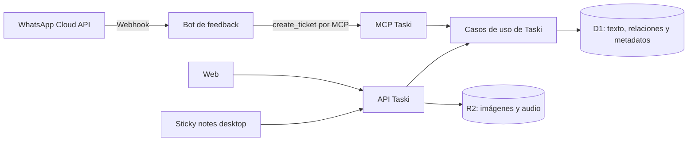

# Q2 · Segunda fase

Q2 es una etiqueta de fase posterior a v0.1; no fija un trimestre/año ni una fecha de entrega. Estas ideas no forman parte del desarrollo actual y se estimarán cuando se concreten sus contratos.

## Imágenes

Adjuntar imágenes a tareas, feedback y conversación desde teléfono o computadora. El archivo vive en Cloudflare R2; su referencia, autor, tamaño, tipo y relación con el ticket viven en D1. Definir límites, formatos, miniaturas, autorización, reintentos y retirada al implementar el bloque.

## Notas de voz

Grabar, escuchar, descartar y enviar audio en feedback y tareas desde la web móvil o de escritorio. R2 guarda el binario y D1, la duración y el vínculo. Verificar permisos y formatos en los navegadores objetivo. La transcripción automática se evalúa aparte.

## Feedback desde WhatsApp

Un mensaje directo de texto al bot de la instalación crea automáticamente un ticket de tipo `feedback`. El bot recibe el mensaje por un webhook de WhatsApp Cloud API, valida la firma y el remitente y llama a `create_ticket` mediante el MCP de Taski. Usa el identificador del mensaje para reintentar sin duplicar el ticket. Cuando Taski confirma el guardado, el bot responde con el código y el enlace.

La primera entrega cubre texto de remitentes autorizados. Cada instalación configura el número, el acceso MCP y la relación entre remitentes y miembros del equipo. La auditoría conserva el origen del aporte. Consulta el [issue Q2-13](https://github.com/Partela-Organization/taski/issues/87) y la [plataforma oficial de WhatsApp](https://developers.facebook.com/documentation/business-messaging/whatsapp/overview/).

## Guía de MCP dentro de la web

La web autenticada incluye [Conectar MCP](web.md#conectar-mcp-desde-el-encabezado) debajo de la navegación. La guía muestra la URL de la instalación, el ID del miembro y configuraciones copiables para Codex y Claude Code. El código de acceso se carga en la terminal como `TASKI_CODE`.

## Sticky notes de escritorio

Experiencia inspirada en Stickies de Apple: notas pequeñas en la laptop, independientes o vinculadas a tareas, sincronizadas con la web. Evaluar un cliente de escritorio y su tecnología después de un prototipo.

- Texto y relaciones en D1; imágenes/audio en R2.
- Misma API que la web.
- Posición/tamaño de ventana como preferencias del dispositivo si procede.
- Definir sincronización, conflictos y modo sin conexión antes de implementarlos.
- Evaluar coordinación en vivo cuando se necesite; no obliga a incorporar Durable Objects ahora.

## Dataflow

R2 almacena archivos; la API y D1 mantienen la relación y versión del contenido. La configuración del bucket corresponde a cada instalación cuando llegue esta fase.
