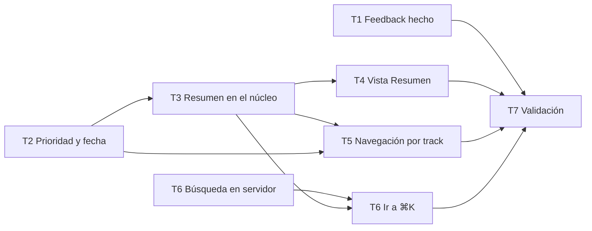

# Resumen y tracks · Plan por bloques

Plan para que Taski sirva como recap rápido: ver cómo va cada track, qué vence primero y qué falta, sin recorrer la lista de tickets. La propuesta visual se revisó el 27 de noviembre de 2026. Cada bloque se entrega en su propio PR con pruebas, documentación y `npm run check`.

| Bloque | Estado |
| --- | --- |
| T1 · Check de hecho en feedback | Implementado: [web](web.md#compartir-feedback-b8-01) y filtro `open` de la [API](api.md) |
| T2–T7 | Pendientes |

## Conceptos

- **Track**: un área configurada de la instalación (por ejemplo, Pagos o Limpieza) a la que se añade **prioridad** (P1–P3) y una **fecha límite** opcional. Los IDs y etiquetas de las áreas siguen en la configuración. Prioridad y fecha cambian con frecuencia, por eso se guardan en D1 y se auditan.
- **Progreso de un track**: tareas `done` / tareas totales del área. Solo cuenta el tipo `task`, porque el feedback no mide avance. Las tareas `in_review` se muestran como un segmento aparte, más claro.
- **Estado de un track**, calculado en el dominio a partir de la fecha de la instalación:
  - **Vencido**: la fecha ya pasó y el progreso no llega al 100%.
  - **En riesgo**: quedan siete días o menos y falta al menos el 25%.
  - **En camino**: tiene fecha y no cumple ninguna de las condiciones anteriores.
  - **Sin fecha**: no tiene fecha límite.
- **Feedback hecho**: un feedback con estado `done`. No se añade un campo nuevo. La regla actual se mantiene: un agente no marca `done` salvo autorización explícita.

## Orden y dependencias

T1, T2 y la parte de servidor de T6 pueden avanzar en paralelo.

## T1 · Check de hecho en feedback

Entrega el valor más inmediato y no requiere migraciones.

- **API y MCP**: `list_tickets` acepta `open: true` para excluir `done`. El filtro actual por `status` admite un solo valor y no puede expresar "todo menos terminado". Hay que actualizar `docs/api/openapi.json`, el cliente y la descripción de la herramienta MCP.
- **Web**: cada fila de Feedback lleva una casilla real (`input type="checkbox"`) con un área táctil de 44 px. Al marcarla, `update_ticket` cambia el estado a `done`; al desmarcarla, vuelve a `todo`. La petición envía `expectedVersion` y una clave idempotente. Mientras el servidor no confirma, la casilla queda en estado pendiente; ante un conflicto se relee el ticket, como en el panel.
- **Filtros**: **Abiertos** (predeterminado), **Hechos** y **Todos**, guardados en el navegador como la presentación.
- **Presentación**: los hechos se ven atenuados y tachados, con la etiqueta Hecho. Quién y cuándo lo marcó se consulta en la actividad del detalle.
- **Pruebas**: el filtro `open` en la API, que un agente que intenta marcar `done` recibe `REVIEW_REQUIRED`, y un recorrido Playwright que marca, desmarca y filtra.
- **Documentación**: la sección de feedback de [web](web.md) y las reglas de [tickets](ticket-rules.md).

## T2 · Prioridad y fecha por track

- **Migración** `0009_area_plans.sql`:
  - Tabla `area_plans`: `area_id` como clave primaria, `priority` entre 1 y 3 (2 por omisión), `target_date` con formato `YYYY-MM-DD` o `NULL`, `version`, `updated_by` y `updated_at`.
  - Tabla `area_activity` para la auditoría. La tabla `activity` no sirve porque exige `ticket_id`. Guarda el actor, los valores antes/después y el canal, en el mismo lote que el cambio.
- **Dominio** `src/domain/area.ts`: tipo `AreaPlan` y validación de prioridad y fecha. Un área sin fila equivale a P2 sin fecha.
- **Aplicación**: un `AreaPlanService` con el puerto `AreaPlanRepository`. Se apoya en la tabla de idempotencia existente con la operación `update_area`. Valida que el área exista en la configuración (`UNKNOWN_AREA`) y exige la versión consultada (`VERSION_CONFLICT`).
- **API y MCP**: dos operaciones nuevas, `list_areas` (áreas con su plan y versión) y `update_area` (`areaId`, `priority`, `targetDate`, `expectedVersion`, `idempotencyKey`). No se incluyen en `get_project`, porque esa respuesta usa `configVersion`/`notModified` y debe seguir dependiendo solo de la configuración. Las herramientas MCP pasan de 8 a 10; hay que revisar las instrucciones del servidor y el contexto incremental.
- **Agentes**: pueden cambiar prioridad y fecha porque el cambio queda auditado. Es una decisión abierta: si el equipo prefiere reservarlo a personas, se añade una política como la de `done`.
- **Web mínima**: en la agrupación **Por área**, el encabezado de cada sección muestra la prioridad y la fecha y permite editarlas. La vista completa del track llega en T5.
- **Pruebas**: carreras y reintentos sobre D1 emulado, auditoría atómica y API/MCP con SDK.
- **Documentación**: [modelo de datos](data-model.md), [auditoría](audit.md), [API](api.md), [MCP](mcp.md) y [cliente](client.md).

## T3 · Resumen en el núcleo

Hoy la lista pagina de 20 en 20, y las cifras no pueden calcularse en el navegador con páginas parciales.

- **Configuración**: `timezone` de la instalación (por ejemplo, `America/Caracas`) para calcular "hoy", "vencido" y "esta semana". Requiere ampliar el esquema y subir `configVersion`.
- **Repositorio**: `summary()` agrega con `GROUP BY area_id, type, status` las filas con `deleted_at IS NULL`, y cuenta las tareas cerradas en los últimos siete días a partir de `activity` (cambios de estado hacia `done`).
- **Siguiente paso de cada track**: la tarea `in_progress` más antigua; si no hay, una `todo` resaltada; si no, la `todo` más antigua.
- **Dominio**: funciones puras que se prueban sin plataforma:
  - `trackHealth(plan, counts, today)` devuelve el estado del track.
  - `progressText(summary)` genera el texto con barras para Telegram (`▓▓▓▓▓░░░░░ 54%`). La web y el MCP usan la misma función para que el formato coincida.
- **Operación** `get_summary` en API y MCP, con estos datos:
  - por track: progreso, por revisar, por hacer, prioridad, fecha, estado y siguiente paso;
  - totales y feedback abierto;
  - con `format: "text"`, solo el texto para Telegram.

  Así un agente puede responder "¿cómo vamos?" o enviar las barras en una sola llamada.
- **Pruebas**: tabla de casos de `trackHealth` (bordes de fecha y zona horaria), agregados con tickets eliminados y medición de la respuesta compacta del MCP.

## T4 · Vista Resumen en la web

- **Vista**: `summary` en `views.ts`, primera en la navegación. `defaultView` acepta `"summary"`, que pasa a ser la vista inicial en escritorio; en el teléfono, Resumen y Feedback quedan como pestañas.
- **Componentes** en `src/web/app/summary/`:
  - **Lo que toca ahora**: tracks vencidos y próximos con su siguiente paso, revisiones pendientes y feedback abierto. Cada elemento enlaza a su destino.
  - **Cifras**: avance total, cerradas esta semana, tracks en riesgo y próxima entrega.
  - **Tracks**: lista con barras de progreso y un selector **Prioridad / Fecha límite** que se guarda en el navegador.
  - **Copiar para Telegram**: copia al portapapeles el texto de `get_summary`.
- **Accesibilidad**: cada barra lleva `role="img"` y una etiqueta con los números. El estado se muestra como texto e icono, no solo con color, y se verifica en tema oscuro.
- **Actualizar**: el mismo patrón manual que la lista; no hay push.
- **Pruebas**: Playwright con fixtures y un recorrido Worker/D1 efímero con datos ficticios que revisa cifras, orden y texto copiado.
- **Documentación**: sección nueva en [web](web.md) con una captura ficticia.

## T5 · Navegación por track

- **Barra lateral**: lista de tracks por prioridad, con mini barra y porcentaje. Las teclas 1–9 abren cada track cuando el foco no está en un campo de texto.
- **Vista de track**: ruta `/track/:areaId`, que funciona al recargar. Incluye:
  - una fila de chips para saltar a otro track;
  - un encabezado con prioridad y fecha editables (T2) y el estado;
  - la barra grande con su leyenda;
  - captura en línea con el área ya asignada;
  - secciones **Por hacer**, **Por revisar** y **Terminado** (plegada).
- **Detalle**: abrir un ticket conserva el panel derecho actual.
- **Pruebas**: navegación por teclado, rutas con recarga y edición con conflicto de versión.

## T6 · Ir a… (⌘K)

- **Servidor**: `list_tickets` acepta `query`, que busca por código o título en todo el proyecto. Hoy la búsqueda solo cubre las páginas ya cargadas. También queda disponible en MCP.
- **Web**: paleta con ⌘K / Ctrl+K y un botón en la barra lateral y en el teléfono. Usa el patrón *combobox* accesible con foco atrapado, Esc para cerrar y ↑↓ con Enter. Primero muestra tracks (datos de T3) y después tickets.
- **Pruebas**: teclado, lector de pantalla (roles y anuncio de resultados) y la búsqueda paginada en la API.

## T7 · Validación y entrega

- Recorrido completo con datos ficticios en escritorio y en un iPhone físico, siguiendo la [matriz de accesibilidad](verification/b7-accessibility.md).
- Actualizar [README](../README.md), el [roadmap](roadmap.md) y las capturas.
- Revisar que el texto de Telegram coincida con el que ya usa el equipo.

## Decisiones abiertas

1. ¿Pueden los agentes cambiar prioridad y fecha de un track? La propuesta es que sí, con auditoría.
2. Umbral de **En riesgo**: la propuesta es siete días y 25% pendiente. Una alternativa es comparar el ritmo de la última semana con lo que falta.
3. ¿Resumen pasa a ser la vista inicial de todos en escritorio, o solo de quien lo elija en `defaultView`?
