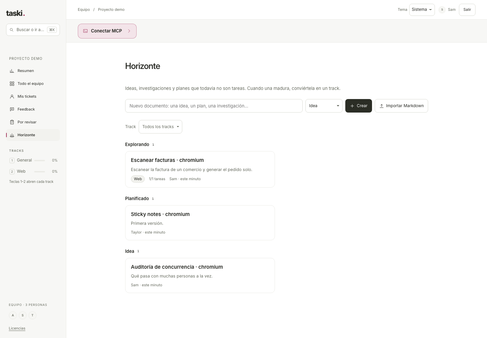
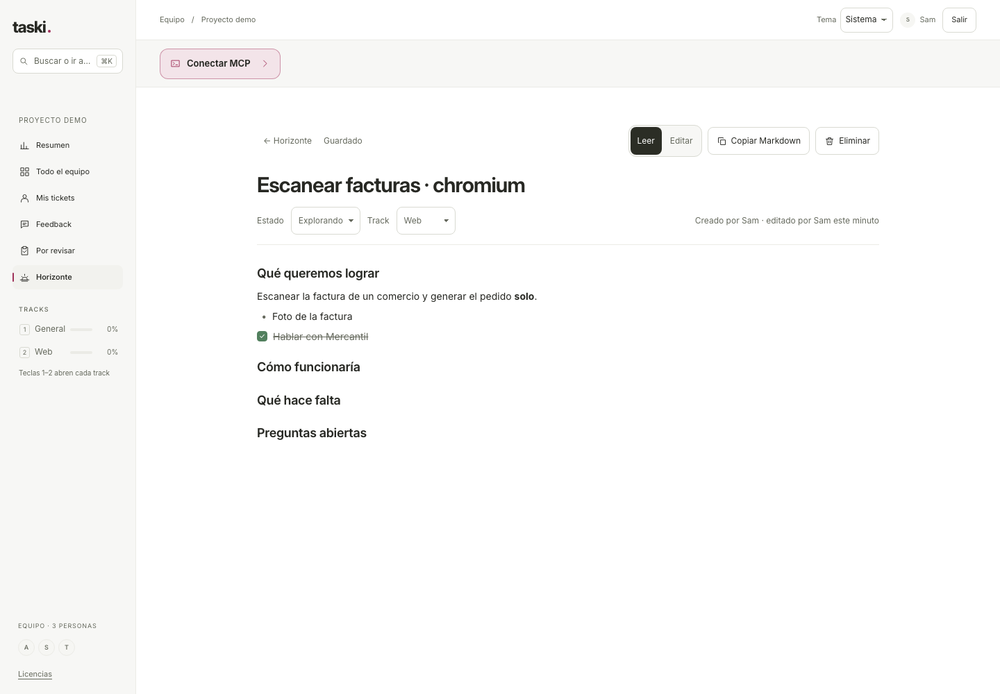
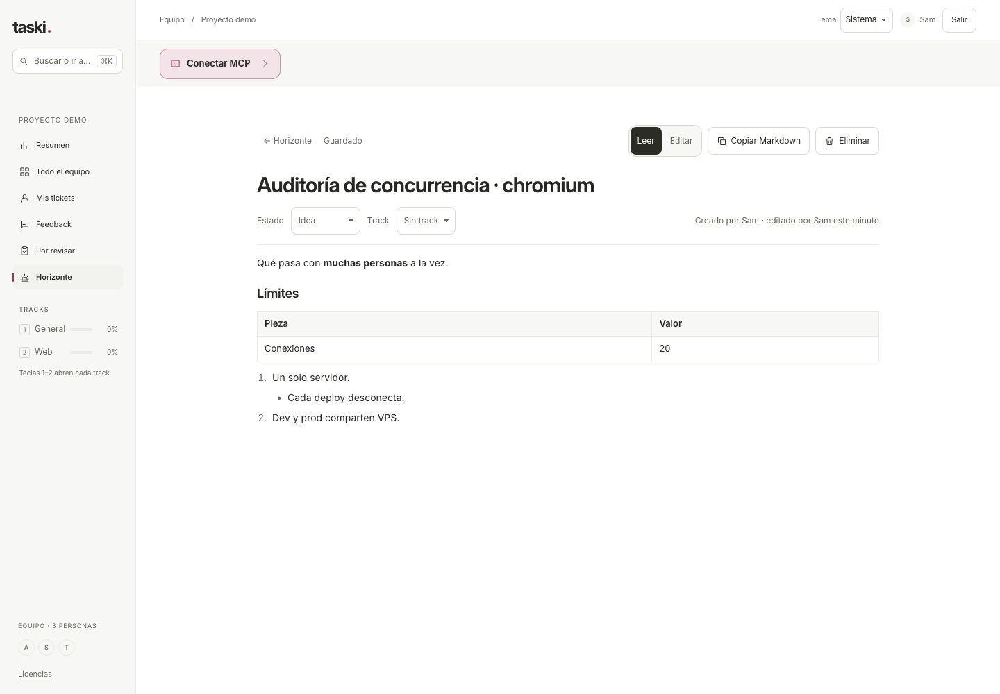
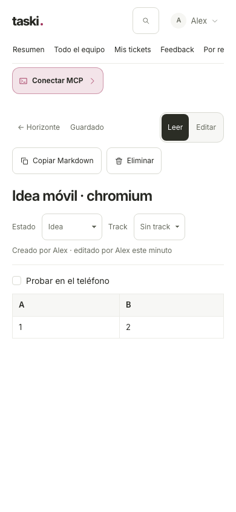

# Horizonte · Verificación H4

Cierre del [plan de Horizonte](../horizonte.md) con datos ficticios sobre Worker/D1 efímero. Lo cubre [`tests/ui/horizon.spec.mjs`](../../tests/ui/horizon.spec.mjs) dentro de `npx playwright test`, en Chromium y WebKit.

## Recorrido

1. **Crear desde plantilla**: título y plantilla Idea; el documento abre en Editar con los títulos de la plantilla.
2. **Escribir con bloques**:
   - un párrafo con `**negrita**`;
   - Enter y `- ` crean una lista;
   - Enter sobre una lista vacía vuelve a texto;
   - `/` → **Tarea**, que luego se marca como hecha;
   - se cambian el estado y el track.
3. **Autoguardado**: "Guardado" aparece y `GET /api/v1/horizon/<id>` devuelve el Markdown exacto.
4. **Leer y volver**: se ve la negrita, el documento sobrevive a una recarga y, de vuelta en la lista, aparece en Explorando con "1/1 tareas". El filtro por track lo oculta.
5. **Importar Markdown** con tabla y listas anidadas: abre en Leer, la tabla tiene encabezados y celdas reales y la numeración sigue (1., •, 2.).
6. **⌘K**: "auditoría de concurrencia" encuentra el documento en el grupo Horizonte y Enter lo abre.
7. **Conflicto**: otra sesión cambia el estado mientras se escribe. Taski conserva el texto, muestra el aviso y **Guardar mi versión encima** lo guarda.
8. **Eliminar**: la confirmación enfoca Cancelar; al confirmar vuelve a la lista con "Documento eliminado." y la API responde 404.
9. **Teléfono** de 390 px: lista y documento sin desbordamiento horizontal.

## Cobertura del núcleo

| Prueba | Qué comprueba |
| --- | --- |
| `tests/horizon-rules.test.mjs` | Markdown ↔ bloques con todos los tipos, viaje de ida y vuelta idéntico, 9 casos de bloques inválidos y extracto con tareas. |
| `tests/horizon.test.mjs` | API y MCP: crear desde Markdown, idempotencia, filtros, versión y conflicto, cambio vacío, área desconocida, auditoría solo de alta y borrado solo por persona. |
| `tests/hosted-runtime.test.mjs` | El Worker alojado sirve `/horizonte` y `/horizonte/<id>`. |

Las pruebas de navegador encontraron tres fallos del editor, ya corregidos:
- el modo saltaba de Editar a Leer al escribir el primer párrafo;
- un atajo movía el cursor al inicio;
- las tareas vacías de una plantilla contaban como pendientes.

## Despliegue

La instalación alojada aplica `0010_horizon.sql`, añade `"/horizonte"` y `"/horizonte/*"` a `run_worker_first` en su configuración privada y publica el Worker. Para el primer contenido se importan las notas con `POST /api/v1/horizon` o `save_horizon`, con una clave idempotente fija por archivo, para que repetir la importación no duplique documentos.
