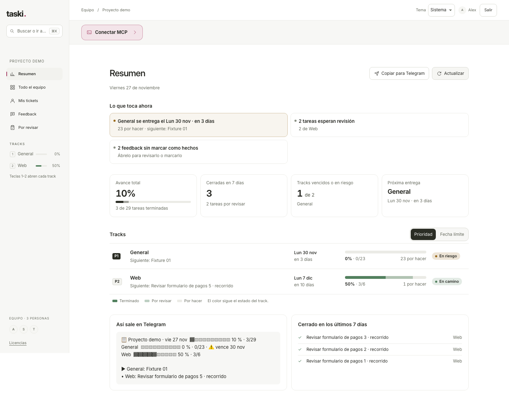
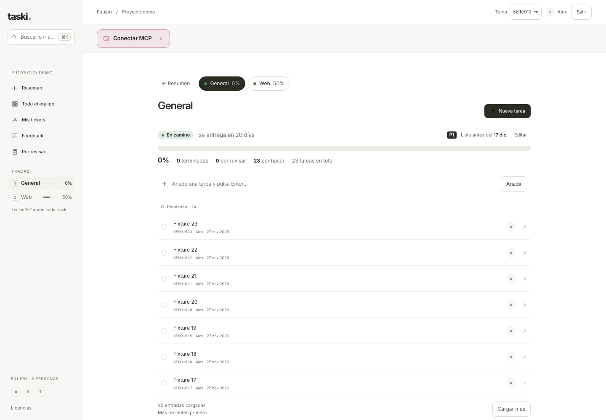
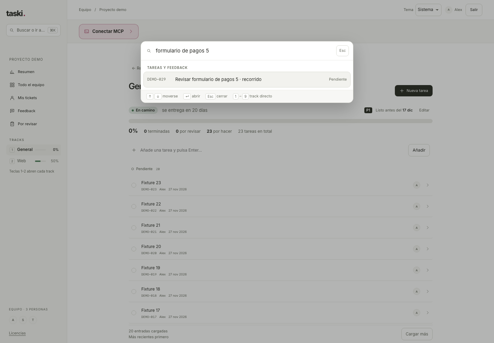
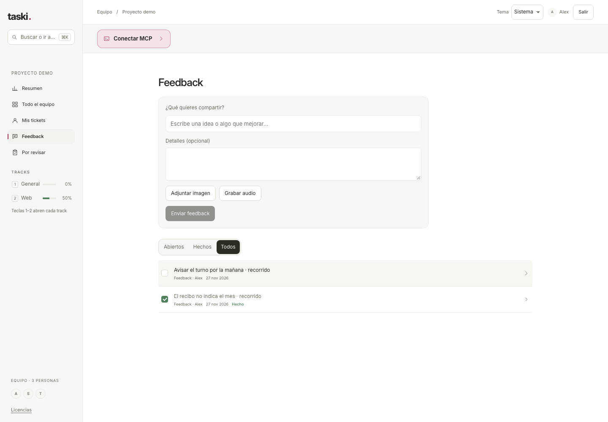
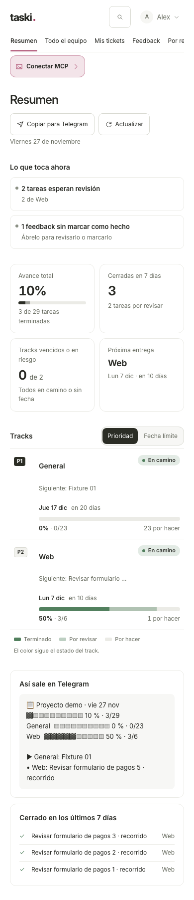

# Resumen y tracks · Verificación T7

Recorrido de cierre del [plan de Resumen y tracks](../tracks.md) (T1–T6), con datos ficticios sobre Worker/D1 efímero. Está en [`tests/ui/tracks-walkthrough.spec.mjs`](../../tests/ui/tracks-walkthrough.spec.mjs). Modifica los planes de los tracks compartidos del fixture, así que es opcional y se ejecuta solo:

```sh
TASKI_WALKTHROUGH=1 npx playwright test tracks-walkthrough --project chromium
```

`npx playwright test` lo omite y conserva las pruebas por bloque de la tabla de abajo.

Las capturas quedan en `test-results/`. Copia las que cambien a esta carpeta y revisa el diff.

## Recorrido

1. Alex entra en escritorio y Taski abre en **Resumen**.
2. Se preparan por API dos tracks: General P1 con fecha en tres días y todo pendiente, y Web P2 con fecha en diez días, cinco tareas (tres terminadas, una por revisar) y dos feedback abiertos.
3. **Actualizar** muestra General **En riesgo** en **Lo que toca ahora**, las revisiones pendientes y el feedback abierto. La barra de Web coincide con `GET /api/v1/summary`.
4. **Copiar para Telegram** copia tal cual el texto de `GET /api/v1/summary?format=text`.
5. La tecla `1` abre `/track/general`. Se cambia la fecha a veinte días desde el propio track y el estado pasa a **En camino**.
6. ⌘K/Ctrl+K, "formulario de pagos 5" y Enter abren la tarea en el panel. Escape vuelve a `/track/general`.
7. En **Feedback**, la casilla **Hecho** cierra un aporte. En **Todos** aparece marcado y el Resumen pasa a "1 feedback sin marcar como hecho".
8. En un teléfono de 390 px, Resumen carga sin desbordamiento horizontal.











## Otras pruebas del plan

| Bloque | Cobertura automática |
| --- | --- |
| T1 | Filtro `open` en API y MCP, `REVIEW_REQUIRED` para agentes, idempotencia, auditoría y reintento con respuesta perdida en la web. |
| T2 | Plan de track versionado, idempotente y auditado; carrera de dos primeras ediciones; conflicto y reintento en la web. |
| T3 | Umbrales de estado, zona horaria alrededor de medianoche, agregados con más de una página, tickets eliminados o reabiertos y texto exacto. |
| T4 | Textos de avisos y cifras, orden persistente, etiquetas accesibles de las barras, copia, móvil y tema oscuro. |
| T5 | Lista lateral, teclas 1–9, chips, Atrás, recarga, captura dentro del track y track inexistente. |
| T6 | Búsqueda `query` con comodines literales y paginación; paleta con teclado, foco y botón en el teléfono. |

El recorrido de cierre encontró un fallo, corregido en este bloque: el plan de un track editado desde otra sesión no se recargaba al cambiar de vista ni con **Actualizar**, y guardar acababa en conflicto. Una prueba de `track-plan-integration.spec.mjs` lo cubre en la suite normal.

## Pendiente con el equipo

- **iPhone físico**: repetir los pasos 1, 5, 6 y 8 en Safari siguiendo la [matriz de accesibilidad](b7-accessibility.md#repetir-en-un-iphone-físico). Igual que en B7-04, los motores automatizados no sustituyen esta comprobación.
- **Formato de Telegram**: revisado. El texto sigue el mensaje que el equipo ya envía con su bot: barra `▓▓▓░░░░░░░ 30 % · 3/10` con el total en la cabecera, `⚠️` como marcador de vencido o en riesgo y `▶` para el siguiente paso, en texto plano.
- **Instalación alojada**: aplicar la migración `0009_area_plans.sql` antes de publicar el Worker y añadir `"timezone"` a `TASKI_INSTALLATION_JSON` para que "hoy" y los vencimientos usen la hora local.
